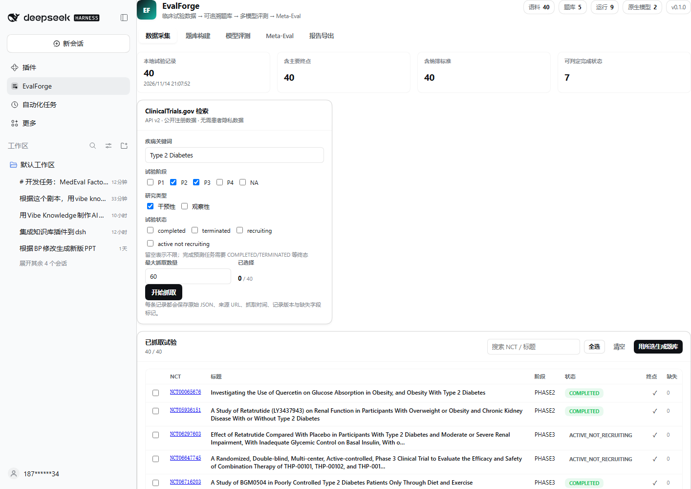
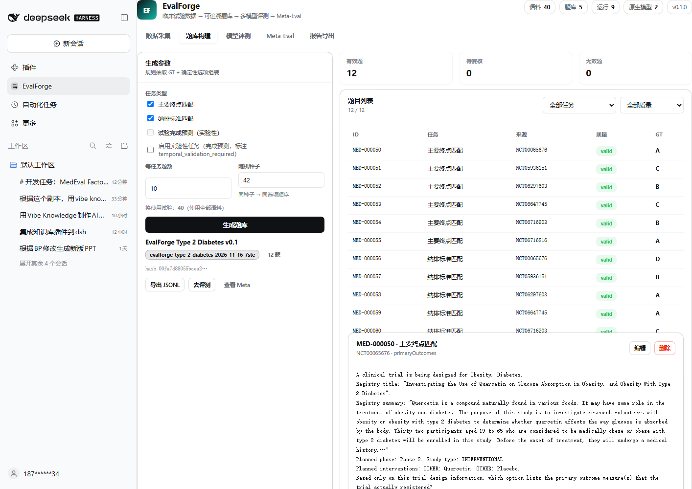
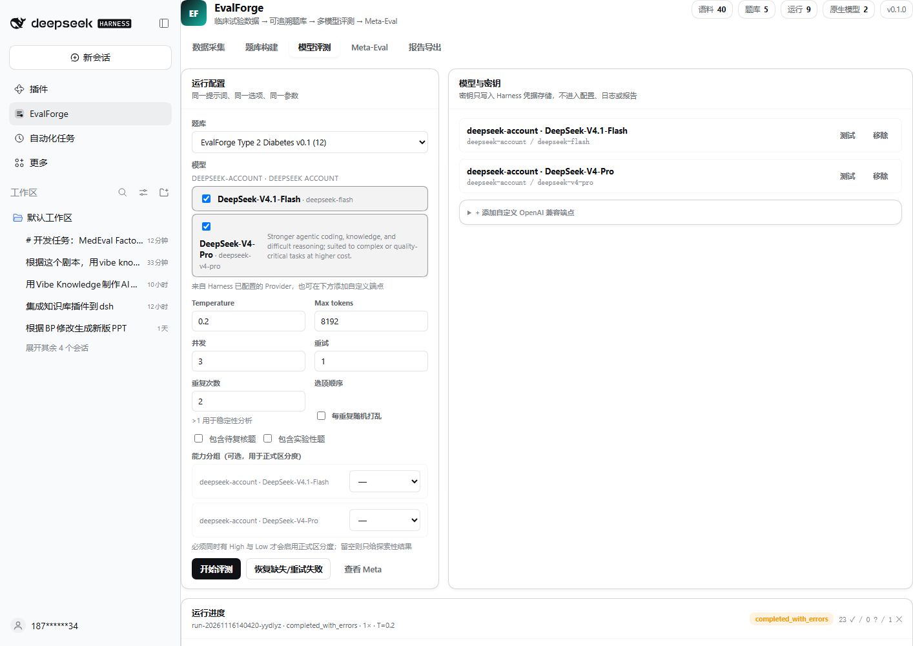
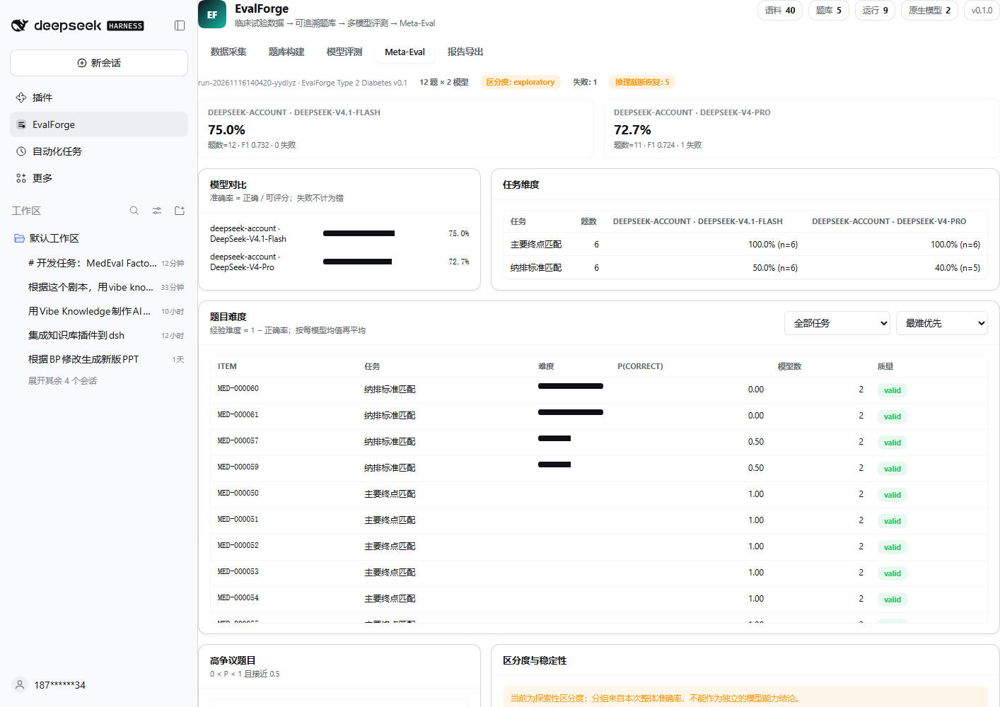
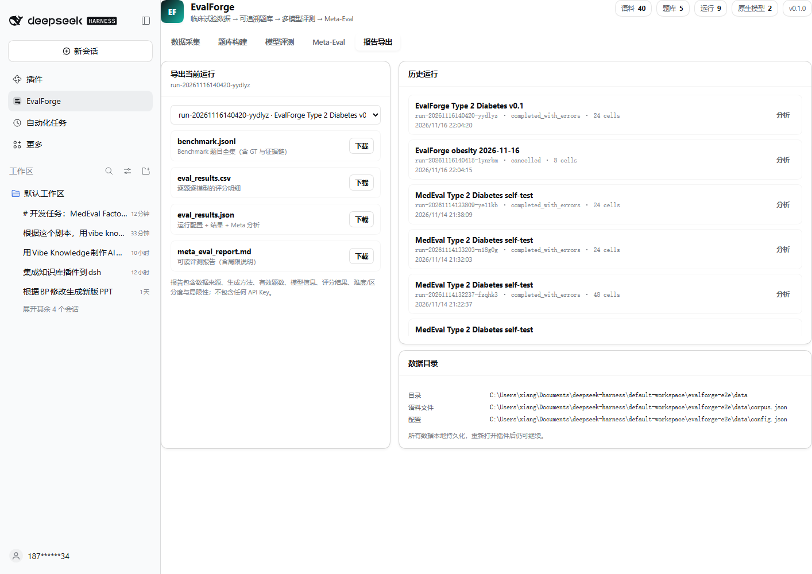

# 端到端验证记录（v0.1）

本文件只记录**实际执行过**的验证，包含失败与迭代过程。所有数字来自本机 DSH 实例的持久化运行记录，不是模拟值。

> 2026-11-16：插件由 *MedEval Factory* 更名为 **EvalForge**（包名 `dsh-plugin-evalforge`、路由 `/api/evalforge`、数据目录 `$DSH_HOME/evalforge`）。数据模型、题库生成规则与评分逻辑未改动；下表保留更名前后的真实运行记录。

## 1. 环境

| 项 | 值 |
| --- | --- |
| DSH | 0.2.1-rc.3（desktop 运行时） |
| 验证方式 | 独立 `web` profile（`evalforge-ui`），与桌面 GUI 隔离，端口 3099 |
| 数据目录 | `EVALFORGE_DATA_DIR=…/evalforge-e2e/data` |
| 注册库 | ClinicalTrials.gov API v2（公开数据） |
| 模型来源 | Harness 原生 `deepseek-account` Provider（`/models` 返回 2 个模型） |

> 为什么不用桌面 profile 做自测：桌面 profile 由 Electron 独占，探针会在真实宿主里触发 `process.exit`。因此验证 profile 复制了同样的 bundle 组合与 Provider 配置。

## 2. 数据采集

```
条件: Type 2 Diabetes
Phase: PHASE2, PHASE3
类型: INTERVENTIONAL
请求: 40 条
```

结果：**40 条真实试验**，注册库报告 2837 条匹配；1 次请求，0 次重试，耗时 3.1–4.5 s。全部 40 条含主要终点与纳排标准，0 条无效 NCT，0 条重复。

去重与版本：重复抓取同一条件时 `added=0, updated=0`，语料保持 40 条。

## 3. 题库生成

配置：`endpoint_selection + eligibility_criteria_matching`，每任务 6 题，seed 42，`drop_invalid=true`。

| 指标 | 值 |
| --- | --- |
| 生成题数 | 12 |
| valid | 12 |
| needs_review | 0 |
| invalid | 0 |
| 候选记录 | 80（40 × 2 任务） |
| 任务构成 | endpoint 6 / eligibility 6 |
| 题目 ID | MED-000050 … MED-000061 |
| benchmark hash | `00fa7d88…`（每次生成写入，可复算） |

抽样核验（自动测试 + 人工阅读）：

- 正确选项逐字出现在对应注册字段中（`evidence.original_text`）
- 干扰项全部来自其它试验，且与正确答案不同族
- 选项长度受控（0.6–1.6 倍），无“最长即答案”捷径
- 早期版本曾出现三个已修复的缺陷：`Primary Outcome Measure` 占位终点被当作选项、HbA1c 同族不同时间点并存、年龄 ≥18 两条近重复选项。修复后由 `isNearDuplicateOption` 与 `isMeasureFamily` 拦截，并有回归测试覆盖。

## 4. 真实多模型评测

本机 Harness 仅配置了一个 Provider（`deepseek-account`），该 Provider 提供 2 个可用模型。**插件接口支持最多 8 个模型**，其中第 3 个及以后需要额外的 Provider 或自定义端点；当前环境没有可用凭据，因此未伪造第三个模型的结果。

### 4.1 最终验收运行

`run-20261116140420-yydlyz`（EvalForge 更名后的构建），benchmark `EvalForge Type 2 Diabetes v0.1`，prompt `evalforge-mcq-v2`，max tokens 8192，temperature 0.2，24 个单元。

| 模型 | 准确率 | Macro-F1 | 可评分 | 失败 | 平均延迟 |
| --- | --- | --- | --- | --- | --- |
| deepseek-account · DeepSeek-V4.1-Flash | 75.0% | 0.732 | 12 | 0 | 16.1 s |
| deepseek-account · DeepSeek-V4-Pro | 72.7% | 0.724 | 11 | 1 | 33.5 s |

按任务：

| 任务 | V4.1-Flash | V4-Pro |
| --- | --- | --- |
| endpoint_selection | 100% (n=6) | 100% (n=6) |
| eligibility_criteria_matching | 50% (n=6) | 40% (n=5) |

**结论**：主要终点匹配对两个模型都太容易（天花板效应）；纳排标准匹配明显更难，两个模型都答错约一半。这正是 Meta-Eval 想暴露的信息。

失败：1 次 `TIMEOUT`（单次调用超过 180 s 硬上限，被硬截止中断），未计入准确率分母。另有 5 个单元是 `derived_from_reasoning`（推理被截断但已明确给出唯一选项），在 CSV 与报告中单独标注。

**注意抽样波动**：同一题库、同一参数在更名前后的多次运行为 81.8%/75.0%、72.7%/66.7%、75.0%/72.7%。12 道题、temperature 0.2 的样本量下，约 9 个百分点的波动属正常范围——这也是报告强制标注 `n` 的原因。要得到稳定排名需要扩大题量或增加重复次数。

### 4.2 迭代记录（全部保留在同一数据目录）

| run | prompt | max tokens | 重复 | 打乱 | 单元 | 可评分 | 失败 |
| --- | --- | --- | --- | --- | --- | --- | --- |
| …130328 | v1 | 256 | 1 | 否 | 24 | 13 | 11 |
| …130538 | v1 | 1024 | 1 | 否 | 24 | 12 | 12 |
| …130752 | v1 | 4096 | 1 | 否 | 24 | 23 | 1 |
| …131841（UI 触发） | v1 | 4096 | 1 | 否 | 24 | 21 | 3 |
| …132237（稳定性） | v1 | 8192 | 2 | 是 | 48 | 43 | 5 |
| …133203（更名前验收） | v2 | 8192 | 1 | 否 | 24 | 23 | 1 |
| …133809（更名前最终构建） | v2 | 8192 | 1 | 否 | 24 | 23 | 1 |
| …140420（EvalForge 验收） | v2 | 8192 | 1 | 否 | 24 | 23 | 1 (TIMEOUT) |

早期 11–12 次失败全部是 `MAX_TOKENS`：推理模型在给出选项前就把输出预算用光。处理方式分两步：

1. 把默认输出预算提高到 8192，并在 v2 提示词中要求“直接作答、不要逐项复述选项”；
2. 对“预算耗尽但思维链已给出唯一选项”的情况，记录为 `derived_from_reasoning`，既不判错也不伪装成正常回答。

同时修复了一个健壮性缺陷：Provider 适配器不一定响应 abort 信号，因此给每次模型调用加了硬性截止（`timeout + 10%`，上限 5 s），避免单个卡死的流占住评测 worker。`tests/llm.test.js` 覆盖该场景。

### 4.3 稳定性

`run-20261114132237-fzqhk3`：12 题 × 2 模型 × 2 次重复，选项顺序逐次打乱，48 个单元。

该运行用于验证 `repeats > 1` 路径与 `stability` 指标（一致率、逐次正确率波动、选项顺序效应），也是修复前 `MAX_TOKENS` 问题最明显的样本（5/48 失败）。

## 5. 导出

验收运行的四个产物（`dsh-plugin-evalforge/examples/`）：

| 文件 | 大小 | 校验 |
| --- | --- | --- |
| `benchmark.jsonl` | 40 291 B | 12 行，每行含 GT、证据链、QC、干扰项来源 |
| `eval_results.csv` | 4 070 B | 1 表头 + 24 单元，UTF-8 |
| `eval_results.json` | 73 381 B | run + meta |
| `meta_eval_report.md` | 5 852 B | 10 个章节：来源、方法、构成、模型、评分、难度、区分度/稳定性、失败、局限、可复现性 |

## 6. UI 验证

用 headless Chrome + CDP 驱动真实页面（不是静态截图脚本）：打开侧边栏入口 → 依次点击 5 个 Tab → 读取 DOM 文本并截图。

已验证：

- 侧边栏出现 **EvalForge** 入口，页面标题与副标题正确
- 数据采集：40 条记录表格、勾选、状态徽章、缺失字段计数
- 题库构建：12 题列表、质量徽章、题目详情（题干 / 选项 / GT / 证据 / QC）
- 模型评测：原生 Provider 模型列表、参数表单、进度条、逐单元结果表
- Meta-Eval：模型对比、任务维度、难度分布、高争议题、失败统计
- 报告导出：四个下载项、历史运行、数据目录
- 从 UI 点击“开始评测”真实跑完一轮（`run-20261114131841`，24 单元）

截图：







## 7. 自动化测试

```
node --test --test-isolation=none tests/*.test.js
ℹ tests 60
ℹ pass 60
ℹ fail 0
```

覆盖：文本归一化与答案解析、注册库查询构造、分页/去重/429 重试、字段归一化与缺失标记、三类题目生成、唯一答案与近重复检测、六条 QC 规则的正反例、评分与选项映射、准确率/难度/区分度/单调性/稳定性、CSV/JSONL/Markdown 导出、模型网关超时与凭据错误。

`scripts/check.mjs` 另外校验 manifest、导出映射、locale、图标、bundle patch、Host 模块可导入、客户端 bundle 结构。

## 8. 未覆盖的部分

- 只有 2 个真实模型；第 3 个模型的调用路径由单元测试的 fake gateway 覆盖，没有真实结果
- 说明性区分度在 2 个模型时样本过小，报告中明确标注为探索性
- Completion Prediction 未做真实评测（无历史快照，按设计禁止进入正式评测）
- LLM-as-a-Judge 未实现
